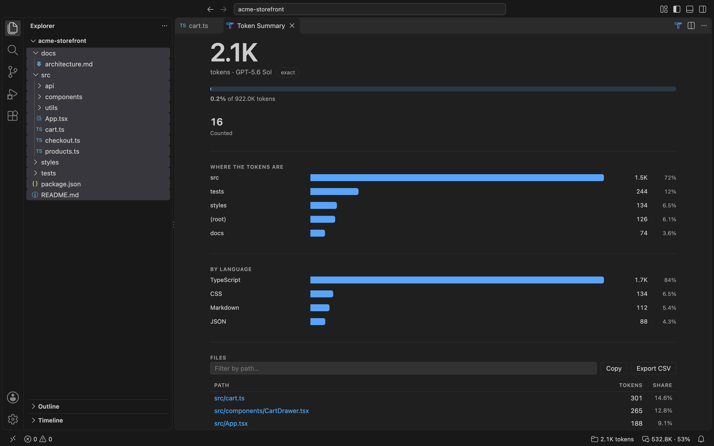
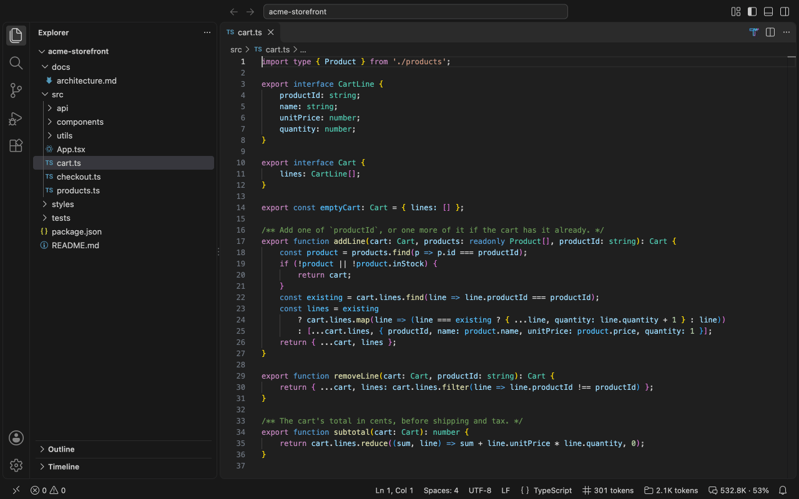
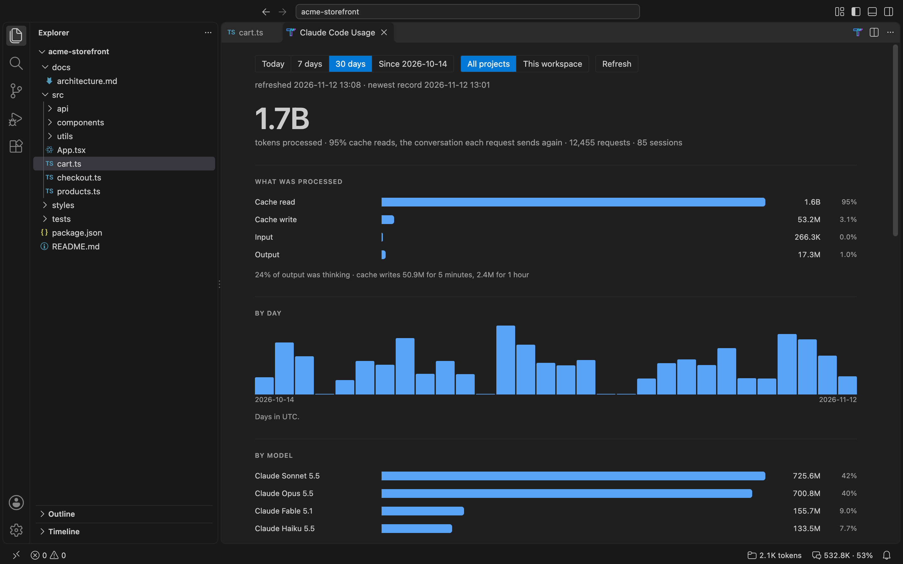
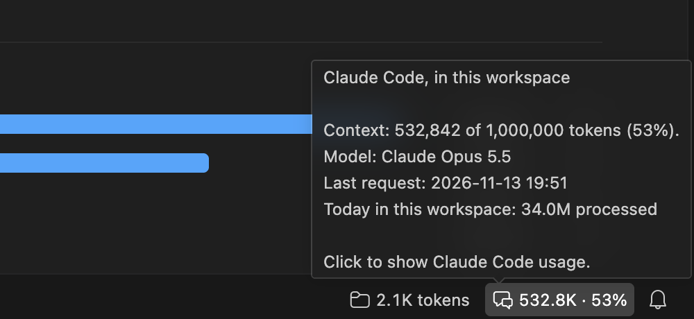

  

  <h1>LLM Tokenizer</h1>

  
<b>The ultimate AI token counter for your IDE.</b> 
  Token counting for 97 models — exact where the tokenizer is public, honestly labelled where it is not.

  

    
    
    
  

---

**Optimized for developers building with LLMs.**

LLM Tokenizer gives you **instant visibility** into your token usage directly within your IDE. Whether you're optimizing prompts, estimating API costs, or ensuring your context window limits aren't exceeded, LLM Tokenizer removes the guesswork.

- **Check Context Limits**: Know instantly if your file fits within the context window of your favorite AI model.
- **Estimate Costs**: Get a clear sense of input token volume before sending requests to expensive APIs.
- **Optimize RAG Pipelines**: Analyze folder-level token counts to better chunk your knowledge base.

Stop copying and pasting into web calculators. Get precise counts right where you code.

<picture>
  <source media="(prefers-color-scheme: light)" srcset="https://raw.githubusercontent.com/matteo-teodori/llm-tokenizer/main/docs/images/token-summary-light.png">
  
</picture>

## Features

### 🎯 Core Features
- **Exact counts, not guesses**: 60 of the 97 supported models are tokenized with the model's own tokenizer. The rest are clearly marked with `≈`.
- **Real-time Token Count**: The active file's token count in the Status Bar
- **Context Limit Warnings**: Indicators at 80% and 100% of the model's *usable input* limit
- **Project-wide Counting**: Workspace totals with caching, cancellation, and multi-root support
- **Multi-file Selection**: Select multiple files or folders in the explorer for a batch count
- **Folder Analysis**: Right-click a folder to count recursively
- **Selection Counting**: Count only the text you highlighted
- **Runs off the UI thread**: Tokenizing happens in a worker thread, so the editor never blocks
- **Persistent Preferences**: Your model choice is remembered
- **Claude Code usage (optional, off by default)**: how many tokens Claude Code processed, by day, project, session and model, read from its own records on your machine. See [Claude Code Usage](#claude-code-usage).

### 🔒 Privacy
**Your code never leaves your machine.** There is no telemetry and no network
request that contains file contents. The only network access is a one-time
download of a model's *vocabulary file* from huggingface.co, which you can turn
off with `llm-tokenizer.downloadTokenizers`; a repository's own settings can
turn it off for that repository, never back on. Claude Code usage, if you turn it
on, reads Claude Code's own session records, the accounts its configuration
file names and its settings files, of which it keeps three entries, on this
machine, and sends nothing anywhere.

### ⚙️ Configuration
- `llm-tokenizer.defaultModel`: Model used until you pick one
- `llm-tokenizer.statusBarDisplay`: `"file"`, `"project"`, or `"both"`
- `llm-tokenizer.ignoreGitignoredFiles`: Exclude gitignored files from folder and workspace totals
- `llm-tokenizer.enableProjectScan`: Turn off workspace-wide counting on very large repositories
- `llm-tokenizer.downloadTokenizers`: Allow the one-time tokenizer download that makes counts exact
- `llm-tokenizer.enableClaudeCodeUsage`: Read Claude Code's session records to show its usage (off by default)
- `llm-tokenizer.claudeCodeDataDirectory`: Claude Code's configuration folder, when Claude Code's own rules would not find it
- `llm-tokenizer.showClaudeCodeUsageInStatusBar`: Show the live context of the Claude Code session in this workspace (off by default)
- `llm-tokenizer.claudeCodeAccountNames`: Names of your own for Claude accounts in Claude Code usage, by account id (set with **Name…**)

## Supported Models

97 models across 13 providers. Every id is checked against the provider's own
documentation, and a model its provider has retired is removed; one it has
only deprecated stays until the date it is shut down. A model you picked from
the status bar is migrated automatically, to the replacement its provider
names; an old id in the `defaultModel` setting keeps working, though VS Code
flags it until you update it.

Where a provider serves the model, the id is the string its API accepts, which
is not always the marketing name — Mistral Small 4 is `mistral-small-2603`,
MiniMax M3 is `MiniMax-M3`, capitals included, and Tencent's Hy3 is `hy3`, never
`hunyuan-hy3`. Open-weight models with no first-party API (Llama, Muse Spark
Open, Muse Glimmer, Gemma 4 E4B) use a lowercase form of their Hugging Face
name, shortened for Llama: `llama-4-scout` is `Llama-4-Scout-17B-16E-Instruct`.

| Provider   | Models | Accuracy |
|------------|--------|----------|
| OpenAI     | GPT-5.6 Sol/Terra/Luna, GPT-5.5, GPT-5.4 (+mini), GPT-5.3 Codex, GPT-5.2, GPT-5.1, GPT-5, GPT-4.1, GPT-4o (+mini), o3, gpt-oss 120b/20b | Exact |
| OpenAI     | GPT-6.1 Sol, GPT-6.1 Terra, GPT-6 Sol, GPT-6 Luna, GPT-6 Astra | Estimated³ |
| Anthropic  | Claude Fable 5.2, Haiku 5.5, Sonnet 5.5, Opus 5.5, Fable 5.1, Opus 5, Sonnet 5, Fable 5, Opus 4.8/4.7/4.6/4.5, Sonnet 4.6/4.5, Haiku 4.5 | Estimated |
| Google     | Gemini 3.1 Pro, 3.1 Flash-Lite, 3 Flash, 2.5 Pro/Flash, Gemma 4 | Exact¹ |
| Google     | Gemini 4 Carbon, 4 Argon, 3.8 Flash, 3.6 Flash, 3.5 Flash-Lite | Estimated² |
| xAI        | Grok 4.7, 4.6, 4.5, 4.3, 4.20, Grok Build 0.1 | Estimated |
| DeepSeek   | DeepSeek V4.1 Flash, V4 Pro | Exact¹ |
| Meta       | Muse Spark Open 816B-A42B, Muse Glimmer 30B, Llama 4 Scout, Llama 4 Maverick, Llama 3.3 70B, Llama 3.1 8B | Exact¹ |
| Mistral    | Mistral Large 4, Large 3, Medium 3.5, Small 4 | Exact¹ |
| Alibaba    | Qwen3.8 Max/Flash/27B/2.4T-A95B, Qwen3.6 27B, Qwen3.6 35B-A3B | Exact¹ |
| Alibaba    | Qwen3.7 Max/Plus/Flash, Qwen3.6 Plus | Estimated |
| Zhipu      | GLM-5.3, GLM-5.3-Flash, GLM-5.3-FlashX, GLM-5.2, GLM-5.1, GLM-5 | Exact¹ |
| Zhipu      | GLM-5-Turbo | Estimated⁵ |
| MiniMax    | MiniMax M3.1 Flash, M3, M2.7, M2.5 | Exact¹ |
| Moonshot   | Kimi K3.1 Pro, K3, K2.7 Code, K2.6 | Exact¹ |
| Xiaomi     | MiMo V2.6 Pro, V2.6 Flash | Exact¹ |
| Tencent    | Hy4 preview, Hy3 | Exact¹ |
| Tencent    | Hy4 | Estimated⁴ |

¹ After a one-time tokenizer download, from the commit of the vocabulary's
repository that this version names, and checked against its hash: a later
change upstream changes no count until a new version moves to it.

² Google's SDK does not map these releases to a published vocabulary yet, so
they fall back to a character estimate.

³ OpenAI has not published which encoding the GPT-6 models use — `tiktoken`'s
own model table stops at `gpt-5` — so they are estimated rather than counted
with an encoding they may not use. They move to exact as soon as that mapping
ships.

⁴ Its tokenizer is not published yet: Tencent has promised Hy4's weights but
not released them.

⁵ Zhipu publishes no tokenizer for GLM-5-Turbo and does not say which
vocabulary it shares with the rest of GLM-5.

## Usage

### Basic Operations
1. **Open a file**: Token count appears in Status Bar (bottom right)
2. **Click Status Bar item** to change model
3. **Right-click a single file** → **Count Tokens** (shows a popup notification with the token count)
4. **Right-click a folder** (or multiple files) → **Count Tokens** (opens a summary showing where the tokens are, by folder and by language)
5. **Select text** in editor → **Count Tokens** to count only the selection

### Configuration
Open Settings (Ctrl/Cmd+,) and search for "LLM Tokenizer":
- **Default Model**: the model used until you pick one from the status bar
- **Status Bar Display**: `"file"`, `"project"`, or `"both"` (default `"both"`)
- **Ignore Gitignored Files**: exclude `.gitignore` matches from counts (on by default)
- **Enable Project Scan**: turn off workspace-wide counting on very large repositories
- **Download Tokenizers**: allow the one-time download that makes counts exact
- **Enable Claude Code Usage**, **Claude Code Data Directory**, **Show Claude Code Usage in Status Bar** and **Claude Code Account Names**: see [Claude Code Usage](#claude-code-usage)

### Context Warnings
- **Normal**: under 80% of the model's usable input limit
- **Warning**: 80–99%
- **Error**: at or over 100%

A leading `≈` means the count is an estimate rather than an exact tokenization.

## Claude Code Usage

How many tokens Claude Code processed, read from the session records Claude
Code keeps on your machine. It is off by default, and reads nothing until you
turn it on. The LLM Tokenizer **T** at the top right of an editor opens it: the
T is there when Claude Code's VS Code extension is installed or the feature is
on, and **Show Claude Code Usage** opens it from the Command Palette either
way. While it is off, the page says what turning it on reads and keeps, with
**Turn On**, and **Open Settings** for **Enable Claude Code Usage**. To hide
the T, right-click the editor's title bar and choose
**Hide 'Show Claude Code Usage'**.

**The panel** shows today, the last 7 or 30 days, or everything since the
history starts, for all projects or for this workspace, and for every Claude
account or one:
- tokens processed, split into input, cache writes, cache reads and output,
  with the share of it that was cache reads;
- a column per day, in your time zone;
- models, the main conversation against subagents and workflows, and effort;
- the Claude accounts the requests were made with, projects and sessions,
  sortable, each session with its active time, and the usage limits you
  reached, newest first; a long list shows ten rows a page, and a swipe or
  the ‹ › beside its heading turns the page;
- diagnostics: what was read, what was skipped and why, and where from.

<picture>
  <source media="(prefers-color-scheme: light)" srcset="https://raw.githubusercontent.com/matteo-teodori/llm-tokenizer/main/docs/images/usage-panel-light.png">
  
</picture>

*Processed* is everything a request sent or received: input, cache writes,
cache reads and output. Cache reads are most of it, and the total's line says
how much: Claude Code sends the conversation again with every request and the
cache serves it, so a single prompt that makes dozens of model calls on a
large context processes tens of millions. A total marked `≥` is a lower bound:
some request did not report every counter, or the records are still being
read. While they are, the first time above all, the panel says so, with how
many of the files it has gone through, and shows the totals as they grow.

*Active* is a session's time between requests in the range, its subagents'
included, leaving out every pause of over 15 minutes: Claude and its tools at
work, and your replies within that, rather than how long the session stayed
open.

**Accounts.** Claude Code records, in each session's transcript, which Claude
account and organization the session is signed in to, by id, and records it
again when the session is resumed under another; the Accounts section splits
the tokens by the account each request was made with, a session's subagents
included, and the filter beside the scope shows one account at a time: its
totals, days, models, projects, sessions and usage limits, each limit said to
be the account's that reached it. An account is named as Claude Code names it, by its email and,
unless it is a personal one, its organization, from Claude Code's own
configuration file (`~/.claude.json`, or `.claude.json` in
`CLAUDE_CONFIG_DIR`, or `.config.json` in Claude Code's configuration folder,
`~/.claude` or `CLAUDE_CONFIG_DIR`, the name older versions gave it): the
account it is signed in to now, marked *signed in now*, and every account it
keeps a list of. Where both `~/.claude.json` and
`~/.claude/.claude.json` are in use, by Claude Code started without
`CLAUDE_CONFIG_DIR` and with it, both name accounts, the newer name first,
and the one written last says which is signed in now. The history keeps those names,
so an account you have since signed out of keeps its name; one never named
there is *Account 3*, by a number the history gives each account as it first
sees it, and keeps. Below each, when it was used and in which projects tell
it apart, and **Name…** gives it a name of your own, kept in **Claude Code
Account Names** by its id (on hover). A session resumed under another
account, after a usage limit say, counts under each for its own requests, and
the limit under the account that reached it; one from before Claude Code
recorded accounts counts under the first account it records, its older
requests included. Sessions whose transcripts record no account are *Not
recorded*: those Claude Code wrote before it began
recording accounts, around version 2.1.318 in November 2026, those signed in
with an API key or through a cloud provider, and those whose transcripts
Claude Code had deleted before this version first read the history.

**The status item** (**Show Claude Code Usage in Status Bar**) shows how full
the context of the Claude Code session running in this workspace is, as a
share of the model's window where that window is known, amber from 80%. The
window follows Claude Code's own rules: Opus 4.6 and Sonnet 4.6 run in 1M
when a record names `[1m]`, or when the session has held more than 200K;
`CLAUDE_CODE_DISABLE_1M_CONTEXT` holds every model to 200K when it is set in
the editor's environment, in Claude Code's **Environment Variables** setting,
or in the `env` of the organization's managed settings files, and holds a
data folder's own sessions when it is set in that folder's `settings.json`.
A project's own `.claude/settings.json` is not read, nor are policies
delivered by MDM, the Windows registry or as server-managed settings. A context larger
than the window a model was thought to have is shown with a `?`, and no
colour. It reads Claude Code's running-session files too.

<picture>
  <source media="(prefers-color-scheme: light)" srcset="https://raw.githubusercontent.com/matteo-teodori/llm-tokenizer/main/docs/images/usage-status-light.png">
  
</picture>

**Export CSV** copies to the clipboard, per day and model, every count a
hand-made cost calculation needs: requests, input, cache writes (5-minute and
1-hour), cache reads, output, thinking, web searches and fetches. Rows are apart
by what a request's price depends on besides its model: its speed (`fast` is
billed higher), where it ran (`us` is billed higher), and its prompt size (up to
100,000 tokens, up to 200,000, or more: Claude Haiku 5.5 prices a request over
100,000 higher). Its notes say how to read each of those. It gives no prices.
**Copy Sessions** copies the sessions, with each one's active minutes and
account, for a spreadsheet. Both say in their notes which account they hold, when one is
chosen.

**What is kept, and where.** A database in this extension's own storage
(the `claude-code-usage` folder in VS Code's global storage for LLM
Tokenizer) keeps:
- each request's token counts, model, effort, speed, where it ran, time and
  Claude Code version, and its ids: message, request, session, and the
  subagent or workflow run it came from;
- the folder each session started in;
- the Claude account and organization each request was made with, by id,
  and where each session's changed in its transcript; for each account its
  number in the history, and the email and organization name Claude Code
  last gave it, with when;
- each transcript's path, size, file id and how far it was read, with a hash
  of the last 64 bytes read, to tell what changed;
- compactions' sizes, and the usage limits reached, with when they reset and
  the account that reached each, by id;
- the window's process id and this machine's name, which each import writes
  so that two windows never import at once.

Prompts, responses, thinking and tool inputs or results are never kept, and
nothing is sent anywhere. The history outlives Claude Code's own records,
which Claude Code deletes after 30 days by default. A history that can no
longer be read is set aside, left as it is, and a new one started, and the
panel says so until it is cleared; a version that builds part of the history
anew keeps a copy of it as it was, and the copies earlier versions kept are
removed once the history is converted. **Clear Claude Code Usage
History** removes the history and every such copy, and leaves nothing of
them readable on disk. What another window still holds, a copy it has open or a
read it has not finished, goes once that window lets go of it, the next
time any window uses the history; Clear says when a copy has to wait.
Anything still on disk is read again at the next refresh. The panel also
remembers its range, its scope, the account chosen and your time zone, in the
editor's own state.

From Claude Code's configuration file it reads only the account signed in now
(`oauthAccount`) and the accounts it keeps a list of (`knownAccounts`): their
ids, emails and organizations' names. Nothing else in that file is parsed,
and the diagnostics say which files they were. From its settings files,
`settings.json` in `~/.claude` and in each data folder and the organization's
managed settings files, it keeps three `env` entries and nothing else:
`CLAUDE_CONFIG_DIR`, which says where the records are,
`CLAUDE_CODE_SKIP_PROMPT_HISTORY` and `CLAUDE_CODE_DISABLE_1M_CONTEXT`.

Its settings are machine settings, so a repository's settings cannot turn it
on or point it at another folder; the names you give accounts are an
application setting, which only your own settings hold: the Default profile's,
whichever profile is in use. Settings Sync leaves each of them out while LLM
Tokenizer is installed in the profile whose settings hold it. Where it is not,
add them to `settingsSync.ignoredSettings` to keep them on this machine: the
names with LLM Tokenizer installed only in a profile other than Default, or in
a remote window, where it runs on the remote; and all four
(`llm-tokenizer.enableClaudeCodeUsage`,
`llm-tokenizer.claudeCodeDataDirectory`,
`llm-tokenizer.showClaudeCodeUsageInStatusBar` and
`llm-tokenizer.claudeCodeAccountNames`) with it in a profile that uses another
profile's settings. In a dev container, though, the container's settings can
come from the repository's `devcontainer.json`.

**Before uninstalling**, run **Clear Claude Code Usage History**: the editor
may leave this extension's storage on disk after the extension is gone. The
names you gave accounts stay in your settings until you remove **Claude Code
Account Names**, and once LLM Tokenizer is gone Settings Sync no longer leaves
them, or the usage settings, out: with Settings Sync on, remove them first, or
add them to `settingsSync.ignoredSettings`.

### What it counts, and what it cannot see

- Only the machine the extension runs on: other computers and claude.ai are
  not seen. In a remote window that is normally the remote host, and the
  panel names it.
- Nothing Claude Code had already deleted before the first import.
- Sessions run with `CLAUDE_CODE_SKIP_PROMPT_HISTORY`, which keeps no
  transcripts at all.
- `-p` and Agent SDK runs that `CLAUDE_CODE_TRANSCRIPT_LOCAL_GC` trimmed.
- Requests that never reach a transcript, such as title generation and
  possibly compaction.
- A request refused at a usage limit carries no tokens: it is listed as a
  limit reached.
- Records dated more than a day after this machine's clock, which only a
  wrong clock writes: they are kept, and counted once this clock reaches
  them.
- The account of a session Claude Code wrote before it recorded accounts,
  signed in with an API key or through a cloud provider, or whose transcript
  Claude Code had deleted before this version read it: Not recorded. A
  session from before then that was resumed since records the account it was
  resumed with, and its older requests count under that one.

The records' format is internal to Claude Code and may change with it; the
diagnostics say when lines could not be read.

## Accuracy

There are three tiers, and the status bar tells you which one you are in.
Two vocabulary formats are published in the wild — a Hugging Face
`tokenizer.json`, and a bare tiktoken rank table (Moonshot ships the latter) —
and both are read.

| Tier | Shown as | Method | Models |
|------|----------|--------|--------|
| **Exact, offline** | `12,340` | OpenAI's own BPE, bundled | Every OpenAI model tiktoken maps (all but GPT-6) |
| **Exact after one download** | `≈` → `12,340` | The model's published vocabulary (~3–35 MB, cached) | Llama, Muse Spark Open, Muse Glimmer, Gemma/Gemini, DeepSeek, Qwen, Mistral, GLM, MiniMax, MiMo, Hy, Kimi |
| **Estimated** | `≈12,340` | A per-family characters-per-token ratio | Claude, Grok, GPT-6, closed Qwen, recent Gemini, GLM-5-Turbo, Hy4 |

**Why some models are only estimated.** Anthropic and xAI do not publish a
tokenizer for any current model, and Anthropic's own guidance is not to
approximate Claude with OpenAI's tokenizer, which
[it says](https://github.com/anthropics/skills/blob/main/skills/claude-api/shared/token-counting.md)
undercounts Claude by about 15–20% on typical text, and by much more on code or
non-English input. An honest estimate is better than a confident wrong number,
so those models are marked rather than dressed up.

Where a close relative publishes a vocabulary, the ratio is measured on it,
over this repository's own code and docs, and rounded down: o200k_base for
GPT-6, Gemma's vocabulary for recent Gemini, the open Qwen3.6 vocabulary for
closed Qwen, and the family's published vocabulary for GLM-5-Turbo, and Hy4
preview's for Hy4. That puts the total for the measured files slightly
high, but a single file can still read well below its real count, by up to
a third.
Claude's two ratios come from Anthropic's own figures for its two tokenizers.
Grok is the exception: xAI has published tokenizers only for Grok-1 and
Grok-2, none for a current model, so its ratio is inferred rather than
measured, and it is the least reliable number here.

One limitation worth stating plainly: the measured ratios come from English
prose and code, and every ratio is applied per UTF-16 code unit, so an estimate
for CJK text reads substantially low. Exact models are unaffected — this only
applies to counts already shown with a `≈`.

**Known limitation:** only the `.gitignore` at the root of each workspace
folder is read, plus `.git/info/exclude`. Nested `.gitignore` files deeper in
the tree are not applied.

Versions before 2.0 approximated every non-OpenAI model, with `cl100k_base`
and a fudge factor or a flat characters-per-token figure. Measured on this
repository's own code and docs, that undercounted Gemini on JSON by 16.5%, and
Mistral on TypeScript by 7.5% (21% on the worst file) — errors in the direction
that tells you your prompt fits when it does not.

## Requirements

VS Code 1.105.0+

## Changelog

See [CHANGELOG.md](CHANGELOG.md) for detailed release notes.

---

**Author**: [Matteo Teodori](https://github.com/matteo-teodori)
